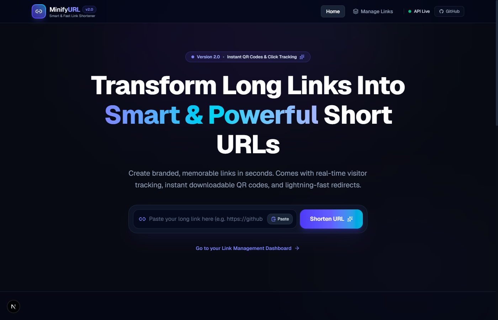
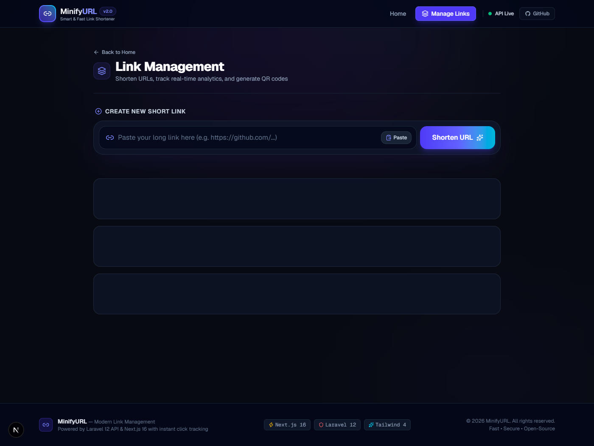

# 🔗 MinifyURL — Modern URL Shortener & Analytics Platform

A high-performance, full-stack URL shortening and link management platform built with **Laravel 12** (backend API) and **Next.js 16** (frontend with Turbopack & React 19). Features a sleek modern dark-themed glassmorphism UI, real-time click tracking, instant QR code generator, and comprehensive analytics.


---

## 🌐 Live Link & Repository

- **GitHub Repository**: [https://github.com/Muzammil-786-ai/URL-Shortener](https://github.com/Muzammil-786-ai/URL-Shortener)
- **Local Frontend**: `http://localhost:3000`
- **Local Backend API**: `http://127.0.0.1:8000`

[](https://vercel.com/new/clone?repository-url=https://github.com/Muzammil-786-ai/URL-Shortener)

---

## 📸 Screenshots Showcase

| 🏠 Landing Page & Hero Shortener | 📊 Links Management & Analytics |
|:---:|:---:|
|  |  |

---

## 🌟 Key Features

### 🚀 Frontend (Next.js 16 + React 19 + Tailwind CSS 4)
- **Modern Glassmorphic Dark UI** — Designed with deep slate colors, ambient background glow, subtle borders, and micro-interactions.
- **Hero Live Shortener** — Create short links directly from the homepage without navigating away.
- **Instant QR Code Generator & Downloader** — High-resolution QR code modal for every link with 1-click **Download PNG** and **Copy Link**.
- **Smart Protocol Auto-Fix** — Automatically prepends `https://` if missing (e.g. typing `github.com/myrepo`).
- **Domain Favicon & Host Chip** — Automatically fetches website favicons and displays target domain pills.
- **One-Click Paste** — Read directly from clipboard with a single click.
- **Confetti Celebration** — Interactive visual confetti burst powered by `canvas-confetti` upon successful creation.
- **Real-Time Analytics Bar** — Live summary metrics:
  - Total links created
  - Total visits / clicks
  - Average clicks per link
  - Top-performing shortcode
- **Search & Sort Dashboard** — Search links by URL or shortcode in real-time; sort by *Latest*, *Most Clicks*, or *Oldest*.
- **Native Web Share & Copy Feedback** — Share links natively on supported browsers and mobile devices.
- **Safe 2-Step Delete Confirmation** — Prevents accidental deletions with a double-click prompt.

### ⚡ Backend (Laravel 12 API)
- **Sub-millisecond 302 Redirects** — Instant redirection to target destinations with click counter incrementation.
- **RESTful JSON API** — Clean endpoints for listing, creating, retrieving, and deleting links.
- **Flexible Database Support** — Configured for zero-config **SQLite** development or production **MySQL / PostgreSQL**.
- **Configured CORS** — Out-of-the-box cross-origin support for the Next.js frontend (`http://localhost:3000`).

---

## 🛠️ Tech Stack

| Layer | Technology | Description |
|---|---|---|
| **Frontend Framework** | [Next.js 16 (App Router)](https://nextjs.org/) | Modern React 19 framework with Turbopack |
| **Styling** | [Tailwind CSS 4](https://tailwindcss.com/) | Modern utility-first CSS framework |
| **Icons & Visuals** | [Lucide React](https://lucide.dev/) | Clean, accessible vector icons |
| **QR Generation** | [qrcode](https://www.npmjs.com/package/qrcode) | Client-side QR generation & PNG export |
| **Celebrations** | [canvas-confetti](https://www.npmjs.com/package/canvas-confetti) | Lightweight celebratory particle effects |
| **Backend Framework** | [Laravel 12](https://laravel.com/) | Robust, expressive PHP API framework |
| **Runtime & Language** | PHP 8.2+ | Server-side execution environment |
| **Database** | SQLite / MySQL | Fast relational storage for links and clicks |

---

## 📂 Project Structure

```text
URL-Shortener/
├── backend/                         # Laravel 12 API application
│   ├── app/
│   │   ├── Http/Controllers/
│   │   │   └── LinkController.php   # CRUD logic & redirect incrementation
│   │   └── Models/
│   │       └── Link.php             # Eloquent model
│   ├── config/
│   │   ├── cors.php                 # CORS configuration for frontend
│   │   └── database.php             # Database connections
│   ├── database/
│   │   ├── migrations/              # Database schema migrations
│   │   └── database.sqlite          # Local SQLite database
│   ├── routes/
│   │   ├── api.php                  # REST API endpoints
│   │   └── web.php                  # Web redirect route (/{short_code})
│   ├── .env                         # Backend environment variables
│   └── composer.json                # PHP dependencies
│
├── frontend/                        # Next.js 16 application
│   ├── src/app/
│   │   ├── components/              # UI Components
│   │   │   ├── Navbar.tsx           # Sticky brand navigation & API status
│   │   │   ├── Footer.tsx           # Tech stack footer
│   │   │   ├── CreateLinkForm.tsx   # Shortener input with paste & confetti
│   │   │   ├── LinkCard.tsx         # Link card with favicons & actions
│   │   │   ├── LinkList.tsx         # Search, sort & link management
│   │   │   ├── StatsOverview.tsx    # Real-time analytics banner
│   │   │   └── QrCodeModal.tsx      # QR code viewer & PNG downloader
│   │   ├── lib/
│   │   │   └── api.ts               # Fetch client for Laravel API
│   │   ├── types/
│   │   │   └── index.ts             # TypeScript interfaces
│   │   ├── links/
│   │   │   └── page.tsx             # Management dashboard (/links)
│   │   ├── layout.tsx               # Root layout & ambient backdrop
│   │   ├── page.tsx                 # Landing page & hero shortener
│   │   └── globals.css              # Custom styling & scrollbar
│   ├── .env.local                   # Frontend environment configuration
│   └── package.json                 # Node dependencies
│
├── screenshots/                     # Preview images for documentation
│   ├── home.png                     # Landing page screenshot
│   └── dashboard.png                # Dashboard screenshot
│
└── README.md                        # Documentation
```

---

## 🚀 Quick Start Guide

### Prerequisites
Make sure you have the following installed on your machine:
- **PHP** ^8.2 with `pdo_sqlite` (or `pdo_mysql`) and `zip` extensions enabled
- **Composer** (PHP package manager)
- **Node.js** 18+ (v20+ recommended) & **npm**

---

### 1️⃣ Backend Setup (Laravel 12)

Open a terminal and navigate to the `backend/` directory:

```bash
cd backend

# 1. Install dependencies
composer install

# 2. Setup environment file
cp .env.example .env

# 3. Generate application encryption key
php artisan key:generate

# 4. Run database migrations (uses SQLite by default)
php artisan migrate

# 5. Start the backend development server
php artisan serve --port=8000
```

> **Backend is now active at:** [http://127.0.0.1:8000](http://127.0.0.1:8000)

#### Optional MySQL Configuration:
If you prefer MySQL over SQLite, edit `backend/.env`:
```env
DB_CONNECTION=mysql
DB_HOST=127.0.0.1
DB_PORT=3306
DB_DATABASE=url_shortener
DB_USERNAME=root
DB_PASSWORD=your_password
```

---

### 2️⃣ Frontend Setup (Next.js 16)

Open a second terminal and navigate to the `frontend/` directory:

```bash
cd frontend

# 1. Install dependencies
npm install

# 2. Configure environment variables (.env.local)
# Create a .env.local file with:
# NEXT_PUBLIC_API_URL=http://localhost:8000/api
# NEXT_PUBLIC_SHORT_BASE=http://localhost:8000

# 3. Start development server with Turbopack
npm run dev
```

> **Frontend is now active at:** [http://localhost:3000](http://localhost:3000)

---

## 📡 API Documentation

### Base URL: `http://localhost:8000`

| Method | Endpoint | Description | Request Body | Response |
|---|---|---|---|---|
| `GET` | `/api/links` | Get all shortened links | None | `Link[]` |
| `POST` | `/api/links` | Create a new short link | `{ "original_url": "https://example.com" }` | `Link` |
| `GET` | `/api/links/{id}` | Get a specific link by ID | None | `Link` |
| `DELETE` | `/api/links/{id}` | Delete a short link | None | `204 No Content` |
| `GET` | `/{short_code}` | Redirects (302) to original URL & increments clicks | None | `302 Redirect` |

### Sample JSON Object (`Link`):
```json
{
  "id": 1,
  "original_url": "https://github.com/facebook/react",
  "short_code": "a9X2zK",
  "clicks": 14,
  "created_at": "2026-10-26T20:50:37.000000Z",
  "updated_at": "2026-10-26T21:04:12.000000Z"
}
```

---

## 💾 Database Schema

The application uses a streamlined table named `links`:

| Field | Type | Attributes | Description |
|---|---|---|---|
| `id` | `BIGINT` | `UNSIGNED`, `AUTO_INCREMENT`, `PRIMARY KEY` | Unique ID |
| `original_url` | `VARCHAR(255)` | `NOT NULL` | The destination URL |
| `short_code` | `VARCHAR(6)` | `UNIQUE`, `NOT NULL` | 6-character random alphanumeric code |
| `clicks` | `INTEGER` | `DEFAULT(0)` | Total number of redirects |
| `created_at` | `TIMESTAMP` | `NULLABLE` | Timestamp when link was created |
| `updated_at` | `TIMESTAMP` | `NULLABLE` | Timestamp of last click/update |

---

## 🖥️ Running in Development

Run both servers concurrently in separate terminals:

```bash
# Terminal 1: Backend API
cd backend && php artisan serve --port=8000

# Terminal 2: Frontend UI
cd frontend && npm run dev
```

Visit [http://localhost:3000](http://localhost:3000) in your browser.

---

## 🛡️ Building for Production

To create an optimized production build of the Next.js frontend:

```bash
cd frontend
npm run build
npm run start
```

---

## 📄 License

This project is open-source and licensed under the [MIT License](LICENSE).
